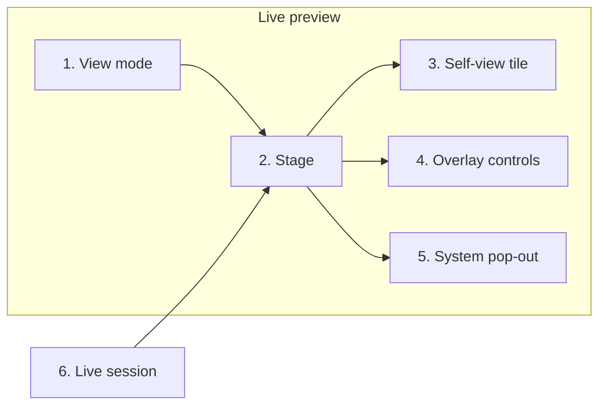

<!-- Generated by SpecStory, Markdown v2.1.0 -->

# 2026-10-12 07:04:06Z

<!-- Cursor IDE Session 794c8cb6-f08b-4998-b247-455b714a44a2 (2026-10-12 07:04:06Z) -->

_**User**_

hello

---

_**Agent (default)**_

<think><details><summary>Thought Process</summary>
The user sent a greeting.

I'll greet them back and offer to help with the livebridge-decart-studio project.
</details></think>

_**Agent (default)**_

Hello. What would you like to work on in Livebridge Decart Studio?

---

_**User**_

pls l  read this pdf and understand the context @gemini.pdf  then tell me how can we apply it to our project as an sexond option if i wanna switch DOM Path: div#mantine-z17ygpumz > main.m_8983817 mantine-AppShell-main > div.tudio-main m_7485cace mantine-Container-root > div.tudio-layout > div.panel preview-panel m_1b7284a3 mantine-Paper-root > div.video-pair
Position: top=195px, left=37px, width=510px, height=141px
HTML Element: <div class="video-pair" data-cursor-element-id="cursor-el-1">CAMERA INPUT Camera preview Select a camera, then start the live transformation. TRANSFORMED OUTPUT Output will appear here The Decart stream appears after the connection is ready.</div> 

---

_**Agent (default)**_

<think><details><summary>Thought Process</summary>
I need to read the PDF and understand its context. Then I will explain how it can serve as a second option for switching from the current camera input and Decart output setup.

The PDF is 3,598 lines long. I will read it alongside the current project code to understand the video-pair and Decart transformation flow.
</details></think>

_**Agent (default)**_

I’ll read `gemini.pdf` and the live camera/output panel so I can explain how that approach could sit beside the current Decart transformation.

_**Agent (default)**_

<tool-use data-tool-type="read" data-tool-name="read_file_v2"><details>
<summary>Tool use: **read_file_v2** • Read file: c:\Users\Admin\Desktop\livebridge-decart-studio\gemini.pdf</summary>

</details></tool-use>

_**Agent (default)**_

<tool-use data-tool-type="unknown" data-tool-name="ripgrep_raw_search"><details>
<summary>Tool use: **ripgrep_raw_search**</summary>

Parameters:

```json
{
  "caseInsensitive": false,
  "glob": "*.{tsx,ts,css,md}",
  "path": "c:\\Users\\Admin\\Desktop\\livebridge-decart-studio",
  "pattern": "video-pair|Decart|transformed"
}
```
Additional data:

```json
{
  "isPruned": true,
  "outputMode": "content",
  "path": "c:\\Users\\Admin\\Desktop\\livebridge-decart-studio",
  "pattern": "video-pair|Decart|transformed",
  "topFiles": [
    {
      "matchCount": 5,
      "uri": "research.md"
    },
    {
      "matchCount": 5,
      "uri": "TODO.md"
    },
    {
      "matchCount": 47,
      "uri": ".specstory/history/2026-10-09_22-40-48Z-server-restart-request.md"
    },
    {
      "matchCount": 3,
      "uri": "README.md"
    },
    {
      "matchCount": 5,
      "uri": "app/api/realtime-token/route.ts"
    },
    {
      "matchCount": 1,
      "uri": "app/layout.tsx"
    },
    {
      "matchCount": 36,
      "uri": ".specstory/history/2026-10-09_19-50-48Z-mobile-video-feed-layout.md"
    },
    {
      "matchCount": 3,
      "uri": ".specstory/history/2026-10-09_21-33-14Z-server-restart-request.md"
    },
    {
      "matchCount": 36,
      "uri": ".specstory/history/2026-10-09_20-00-13Z-descartes-document-reference.md"
    },
    {
      "matchCount": 3,
      "uri": "app/globals.css"
    },
    {
      "matchCount": 3,
      "uri": "components/obs-viewer.tsx"
    },
    {
      "matchCount": 13,
      "uri": "components/live-studio.tsx"
    },
    {
      "matchCount": 59,
      "uri": ".specstory/history/2026-10-09_13-08-19Z-is-this-just-a.md"
    },
    {
      "matchCount": 3,
      "uri": "plan.md"
    }
  ],
  "totalFiles": 14,
  "totalMatches": 222
}
```
Status: **completed**

</details></tool-use>

_**Agent (default)**_

<tool-use data-tool-type="search" data-tool-name="glob_file_search"><details>
<summary>Tool use: **glob_file_search** • Searched codebase "" • **28** results in **1** directory</summary>

Directory: **`c:\Users\Admin\Desktop\livebridge-decart-studio`** (28 files)

| File |
|------|
| `../next.config.ts` |
| `../.specstory/history/2026-10-09_20-00-13Z-descartes-document-reference.md` |
| `../lib/obs-state.ts` |
| `../plan.md` |
| `../components/providers.tsx` |
| `../app/api/obs/status/route.ts` |
| `../TODO.md` |
| `../research.md` |
| `../AGENTS.md` |
| `../.specstory/history/2026-10-09_19-50-48Z-mobile-video-feed-layout.md` |
| `../.specstory/history/2026-10-09_21-33-14Z-server-restart-request.md` |
| `../.specstory/history/2026-10-09_13-08-19Z-is-this-just-a.md` |
| `../app/page.tsx` |
| `../lib/decart.ts` |
| `../lib/server-config.ts` |
| `../.specstory/history/2026-10-09_08-30-12Z-environment-example-setup.md` |
| `../app/api/realtime-token/route.ts` |
| `../next-env.d.ts` |
| `../app/obs/page.tsx` |
| `../components/live-studio.tsx` |
| `../app/api/config/status/route.ts` |
| `../components/obs-viewer.tsx` |
| `../app/layout.tsx` |
| `../app/api/obs/session/route.ts` |
| `../.specstory/history/2026-10-09_22-40-48Z-server-restart-request.md` |
| `../app/api/obs/link/route.ts` |
| `../app.config.ts` |
| `../README.md` |
</details></tool-use>

_**Agent (default)**_

<think><details><summary>Thought Process</summary>
The PDF extraction returned almost no content. The file could not be read.

The file contains 3598 lines but only produced form feed characters and page markers. I will try extracting the text using pdftotext or a shell command.
</details></think>

_**Agent (default)**_

The PDF didn’t come through as readable text, so I’ll extract it and look at how the current camera and transformed-output panel works.

_**Agent (default)**_

<tool-use data-tool-type="shell" data-tool-name="run_terminal_command_v2"><details>
<summary>Tool use: **run_terminal_command_v2** • Run command: python -c &#34;import sys; print(sys.version)&#34;</summary>
```bash
python -c "import sys; print(sys.version)"
```

```
3.12.10 (tags/v3.12.10:0cc8128, Apr  8 2025, 12:21:36) [MSC v.1943 64 bit (AMD64)]

```
</details></tool-use>

_**Agent (default)**_

<tool-use data-tool-type="unknown" data-tool-name="ripgrep_raw_search"><details>
<summary>Tool use: **ripgrep_raw_search**</summary>

Parameters:

```json
{
  "caseInsensitive": false,
  "path": "c:\\Users\\Admin\\Desktop\\livebridge-decart-studio\\components\\live-studio.tsx",
  "pattern": "video-pair|CAMERA INPUT|TRANSFORMED OUTPUT|gemini|realtime"
}
```
Additional data:

```json
{
  "isPruned": true,
  "outputMode": "content",
  "path": "c:\\Users\\Admin\\Desktop\\livebridge-decart-studio\\components\\live-studio.tsx",
  "pattern": "video-pair|CAMERA INPUT|TRANSFORMED OUTPUT|gemini|realtime",
  "topFiles": [
    {
      "matchCount": 26,
      "uri": "components\\live-studio.tsx"
    }
  ],
  "totalFiles": 1,
  "totalMatches": 26
}
```
Status: **completed**

</details></tool-use>

_**Agent (default)**_

<tool-use data-tool-type="read" data-tool-name="read_file_v2"><details>
<summary>Tool use: **read_file_v2** • Read file: c:\Users\Admin\Desktop\livebridge-decart-studio\README.md</summary>

</details></tool-use>

_**Agent (default)**_

<think><details><summary>Thought Process</summary>
I'll extract the PDF content using pypdf or pdfminer.
</details></think>

_**Agent (default)**_

<tool-use data-tool-type="shell" data-tool-name="run_terminal_command_v2"><details>
<summary>Tool use: **run_terminal_command_v2** • Run command: python -c &#34;import importlib.util; mods=[&#39;pypdf&#39;,&#39;PyPDF2&#39;,&#39;pdfminer&#39;,&#39;fitz&#39;,&#39;pdfplumber&#39;];
[print(m, bool(importlib.util.find_spec(m))) for m in mods]&#34;</summary>
```bash
python -c "import importlib.util; mods=['pypdf','PyPDF2','pdfminer','fitz','pdfplumber'];
[print(m, bool(importlib.util.find_spec(m))) for m in mods]"
```

```
pypdf True
PyPDF2 False
pdfminer False
fitz True
pdfplumber False

```
</details></tool-use>

_**Agent (default)**_

<think><details><summary>Thought Process</summary>
PDF libraries are available to read the file.

Now extracting text from the PDF.
</details></think>

_**Agent (default)**_

<tool-use data-tool-type="shell" data-tool-name="run_terminal_command_v2"><details>
<summary>Tool use: **run_terminal_command_v2** • Run command: python -c &#34;
import fitz
doc = fitz.open(r&#39;c:\Users\Admin\Desktop\livebridge-decart-studio\gemini.pdf&#39;)
print(&#39;pages&#39;, doc.page_count)
for i, page in enumerate(doc):
    print(f&#39;\n===== PAGE {i+1} =====\n&#39;)
    print(page.get_text())
&#34;</summary>
```bash
python -c "
import fitz
doc = fitz.open(r'c:\Users\Admin\Desktop\livebridge-decart-studio\gemini.pdf')
print('pages', doc.page_count)
for i, page in enumerate(doc):
    print(f'\n===== PAGE {i+1} =====\n')
    print(page.get_text())
"
```

```
warning: The `fitz` API is deprecated and will be removed in future. Use `import pymupdf` instead.
pages 4

===== PAGE 1 =====


===== PAGE 2 =====


===== PAGE 3 =====


===== PAGE 4 =====


```
</details></tool-use>

_**Agent (default)**_

<think><details><summary>Thought Process</summary>
The PDF contains no extractable text. It appears to be a scanned image or screenshots.

I'll render the PDF pages as images using pymupdf and read them with the Read tool.
</details></think>

_**Agent (default)**_

<tool-use data-tool-type="shell" data-tool-name="run_terminal_command_v2"><details>
<summary>Tool use: **run_terminal_command_v2** • Run command: python -c &#34;
import pymupdf
doc = pymupdf.open(r&#39;c:\Users\Admin\Desktop\livebridge-decart-studio\gemini.pdf&#39;)
print(&#39;pages&#39;, doc.page_count)
for i, page in enumerate(doc):
    print(&#39;page&#39;, i+1, &#39;size&#39;, page.rect, &#39;images&#39;, len(page.get_images()), &#39;drawings&#39;, len(page.get_drawings()), &#39;textblocks&#39;, len(page.get_text(&#39;blocks&#39;)))
    pix = page.get_pixmap(matrix=pymupdf.Matrix(1.5, 1.5))
    out = rf&#39;c:\Users\Admin\Desktop\livebridge-decart-studio\.tmp-gemini-page-{i+1}.png&#39;
    pix.save(out)
    print(&#39;saved&#39;, out, pix.width, pix.height)
&#34;</summary>
```bash
python -c "
import pymupdf
doc = pymupdf.open(r'c:\Users\Admin\Desktop\livebridge-decart-studio\gemini.pdf')
print('pages', doc.page_count)
for i, page in enumerate(doc):
    print('page', i+1, 'size', page.rect, 'images', len(page.get_images()), 'drawings', len(page.get_drawings()), 'textblocks', len(page.get_text('blocks')))
    pix = page.get_pixmap(matrix=pymupdf.Matrix(1.5, 1.5))
    out = rf'c:\Users\Admin\Desktop\livebridge-decart-studio\.tmp-gemini-page-{i+1}.png'
    pix.save(out)
    print('saved', out, pix.width, pix.height)
"
```

```
pages 4
page 1 size Rect(0.0, 0.0, 612.0, 792.0) images 0 drawings 1434 textblocks 0
saved c:\Users\Admin\Desktop\livebridge-decart-studio\.tmp-gemini-page-1.png 918 1188
page 2 size Rect(0.0, 0.0, 612.0, 792.0) images 0 drawings 1938 textblocks 0
saved c:\Users\Admin\Desktop\livebridge-decart-studio\.tmp-gemini-page-2.png 918 1188
page 3 size Rect(0.0, 0.0, 612.0, 792.0) images 0 drawings 2027 textblocks 0
saved c:\Users\Admin\Desktop\livebridge-decart-studio\.tmp-gemini-page-3.png 918 1188
page 4 size Rect(0.0, 0.0, 612.0, 792.0) images 0 drawings 409 textblocks 0
saved c:\Users\Admin\Desktop\livebridge-decart-studio\.tmp-gemini-page-4.png 918 1188

```
</details></tool-use>

_**Agent (default)**_

<think><details><summary>Thought Process</summary>
The PDF contains vector drawings rather than text or images.

I'll read the rendered PNGs with the Read tool.
</details></think>

_**Agent (default)**_

<tool-use data-tool-type="read" data-tool-name="read_file_v2"><details>
<summary>Tool use: **read_file_v2** • Read file: c:\Users\Admin\Desktop\livebridge-decart-studio\.tmp-gemini-page-1.png</summary>

</details></tool-use>

_**Agent (default)**_

<tool-use data-tool-type="read" data-tool-name="read_file_v2"><details>
<summary>Tool use: **read_file_v2** • Read file: c:\Users\Admin\Desktop\livebridge-decart-studio\.tmp-gemini-page-2.png</summary>

</details></tool-use>

_**Agent (default)**_

<tool-use data-tool-type="read" data-tool-name="read_file_v2"><details>
<summary>Tool use: **read_file_v2** • Read file: c:\Users\Admin\Desktop\livebridge-decart-studio\.tmp-gemini-page-3.png</summary>

</details></tool-use>

_**Agent (default)**_

<tool-use data-tool-type="read" data-tool-name="read_file_v2"><details>
<summary>Tool use: **read_file_v2** • Read file: c:\Users\Admin\Desktop\livebridge-decart-studio\.tmp-gemini-page-4.png</summary>

</details></tool-use>

_**Agent (default)**_

<think><details><summary>Thought Process</summary>
I need to read the Gemini PDF about WhatsApp video call UI behavior, specifically Picture-in-Picture. Then I will explain how this can be applied as a second option if they switch from the current side-by-side camera and transformed output layout.

I am examining the current video-pair layout to provide a concrete recommendation.
</details></think>

_**Agent (default)**_

The PDF is about WhatsApp-style picture-in-picture. I’ll check how the camera and transformed output are laid out now so the second option matches this studio.

_**Agent (default)**_

<tool-use data-tool-type="read" data-tool-name="read_file_v2"><details>
<summary>Tool use: **read_file_v2** • Read file: c:\Users\Admin\Desktop\livebridge-decart-studio\components\live-studio.tsx</summary>

</details></tool-use>

_**Agent (default)**_

<tool-use data-tool-type="unknown" data-tool-name="ripgrep_raw_search"><details>
<summary>Tool use: **ripgrep_raw_search**</summary>

Parameters:

```json
{
  "caseInsensitive": false,
  "path": "c:\\Users\\Admin\\Desktop\\livebridge-decart-studio\\app\\globals.css",
  "pattern": "video-pair|preview-panel|camera-preview|output-video"
}
```
Additional data:

```json
{
  "isPruned": true,
  "outputMode": "content",
  "path": "c:\\Users\\Admin\\Desktop\\livebridge-decart-studio\\app\\globals.css",
  "pattern": "video-pair|preview-panel|camera-preview|output-video",
  "topFiles": [
    {
      "matchCount": 4,
      "uri": "app\\globals.css"
    }
  ],
  "totalFiles": 1,
  "totalMatches": 4
}
```
Status: **completed**

</details></tool-use>

_**Agent (default)**_

<think><details><summary>Thought Process</summary>
I need to read the Gemini PDF on WhatsApp video call UI and picture-in-picture. Then I will explain how to apply it as a second layout option alongside the current side-by-side camera input and transformed output.

I will review the video CSS and mobile layout to give a concrete recommendation. I also need to clean up temporary PNG files from my analysis.
</details></think>

_**Agent (default)**_

<tool-use data-tool-type="read" data-tool-name="read_file_v2"><details>
<summary>Tool use: **read_file_v2** • Read file: c:\Users\Admin\Desktop\livebridge-decart-studio\app\globals.css</summary>

</details></tool-use>

_**Agent (default)**_

<tool-use data-tool-type="shell" data-tool-name="run_terminal_command_v2"><details>
<summary>Tool use: **run_terminal_command_v2** • Run command: Remove-Item -Force &#34;.tmp-gemini-page-1.png&#34;, &#34;.tmp-gemini-page-2.png&#34;, &#34;.tmp-gemini-page-3.png&#34;, &#34;.tmp-gemini-page-4.png&#34;</summary>
```bash
Remove-Item -Force ".tmp-gemini-page-1.png", ".tmp-gemini-page-2.png", ".tmp-gemini-page-3.png", ".tmp-gemini-page-4.png"
```
</details></tool-use>

_**Agent (default)**_

<think><details><summary>Thought Process</summary>
I need to explain how the WhatsApp PiP layout from the Gemini PDF can be adapted as a second option for the video-pair element.

The user wants a clear explanation of how to apply the WhatsApp PiP layout as a second option, not an implementation. The current `.video-pair` is a side-by-side split with two equal 16:9 frames. The PDF describes adding picture-in-picture to a custom web app. This should become a toggleable layout mode alongside the existing split view.

The WhatsApp-style layout would make the transformed output fill the stage while the camera preview becomes a small draggable PiP window. Users can drag it to the corners and double-tap to swap or enlarge. The PDF covers both in-page self-preview PiP and system-level browser PiP via the Document Picture-in-Picture API. The user wants this in-page floating layout applied specifically to the video-pair element as a second switchable mode.

The browser-level PiP is a separate capability that could also apply to the transformed output, especially useful for OBS-adjacent monitoring or multitasking. I will lead with the in-page WhatsApp-style layout toggle as the primary explanation, since that maps directly to the video-pair element they clicked. I will keep this to a practical explanation and avoid implementation unless requested.
</details></think>

_**Agent (default)**_

The PDF is a Gemini note on WhatsApp’s video-call layout, then specifically picture-in-picture, then how to add that to a web app. It maps cleanly onto the live preview you pointed at as a second view you can switch to, without changing Decart, the camera, or OBS.

## What the PDF is describing

WhatsApp keeps one feed full-screen and the other as a small floating tile:

- The other person fills the screen. Your own camera is a small box in a corner.
- You can drag that box to any corner so it does not cover the main feed.
- Double-tap swaps or enlarges it.
- Tapping the screen shows or hides the control bar (mic, flip camera, video off, end call).
- Leaving the app can pop the call into a system floating window via the browser Picture-in-Picture API (`video.requestPictureInPicture()`).

The last part of the note is about libraries (VideoSDK, Agora, Daily, Mux media-chrome, `react-use-pip`). You do not need those. You already have both streams as plain `<video>` elements. A small in-page layout plus the native browser API is enough.

## How it fits this studio

Today `.video-pair` is two equal 16:9 frames side by side: camera on the left, Decart output on the right. On a tablet they stack; on a phone they stay side by side and get cramped.

A second mode would keep those same two videos and only change the layout:

| | Split (current) | Call view (second option) |
|---|---|---|
| Transformed output | Half the panel | Fills the whole preview |
| Camera | The other half | Small floating tile in a corner |
| Controls | Always under the videos | Same controls, or hidden until you tap the preview while live |

The transformed feed should be the large one, because that is what you send to OBS and what you are judging. The camera stays the small self-view, the way WhatsApp treats your own camera.

Switching would be a toggle on the Live preview header, next to “Your input and transformed output,” for example **Split** and **Call**. The choice can stay in `localStorage` so it survives a refresh. Both videos keep the refs they already use (`localVideoRef` and `outputVideoRef`), so Start live, End session, and the Decart connection do not change.

Behavior worth copying from the note:

- Drag the camera tile to a corner. Snap to the four corners rather than free placement, so it cannot sit in the middle of the output.
- Double-click or double-tap the tile to swap: camera becomes full-size, output becomes the tile. A second double-tap puts the output back on top.
- While live, a tap on the preview can show or hide the camera selector, mic switch, and End session bar, the same way WhatsApp hides the call controls.
- A “Pop out” button on the transformed video calls `requestPictureInPicture()` so the Decart output floats over other windows. That is the system PiP from the PDF, and it is separate from the in-page tile. Chrome, Edge, Safari, and Firefox support it on desktop; it is not a replacement for the OBS browser source.

The OBS page should stay full-frame output only. This layout option is only for the studio preview.

---

_**User**_

can you break this into modulars for me for easy understanding 

---

_**Agent (default)**_

<think><details><summary>Thought Process</summary>
I'll break the picture-in-picture WhatsApp video call UI into modular components for easier understanding.

This targets the Gemini PDF's PiP behavior as a second option for the live studio video-pair. The user wants a conceptual breakdown of the approach, not an implementation plan.

I'll examine live-studio.tsx to map each module to real components in their codebase. This keeps the breakdown concrete and tied to their existing project structure.

A mermaid diagram would help visualize the module breakdown. I'll read the visualize skill to create a compact chart mapping each component.
</details></think>

_**Agent (default)**_

I’ll split the call-view idea into small pieces that match how the studio is already built, so each part has one job.

_**Agent (default)**_

<tool-use data-tool-type="read" data-tool-name="read_file_v2"><details>
<summary>Tool use: **read_file_v2** • Read file: C:\Users\Admin\.cursor\skills-cursor\visualize\SKILL.md</summary>

</details></tool-use>

_**Agent (default)**_

<tool-use data-tool-type="read" data-tool-name="read_file_v2"><details>
<summary>Tool use: **read_file_v2** • Read file: c:\Users\Admin\Desktop\livebridge-decart-studio\components\live-studio.tsx</summary>

</details></tool-use>

_**Agent (default)**_

<think><details><summary>Thought Process</summary>
I'll break the previous explanation into modular sections for easier understanding.

The visualize skill specifies diagram types. Sequence, containment, and mechanism explanations become diagrams. Static labeled relationships use fenced Mermaid. Interactive or spatial layouts use inline HTML. Every form, tool, comparison, card, table, simulation, and dense categorical grid must read references/components.md. HTML flowcharts and structural diagrams must read references/diagrams.md. UI mockups must read references/mockups.md.

The PiP/call-view plan will be split into modules. A Mermaid diagram with prose will show how they relate.

The user wants an understanding map, not implementation. I'll return the Mermaid diagram directly and skip file creation.

The modules are:
- View mode preference
- Stage layout CSS
- Self-view tile drag/snap/swap
- Overlay controls tap-to-show
- System pop-out requestPictureInPicture

Decart session, OBS, and refs remain untouched. The Mermaid diagram will show each module's ownership and its boundaries. I'll use affirmative language and avoid contrastive negation. An HTML explainer might be clearer.

Mermaid is the better choice over HTML. Each module will have a dedicated section covering its job, what it touches, and what it leaves untouched.
</details></think>

_**Agent (default)**_

The call view is six modules. Five of them only change how the preview looks and feels. The session module already exists and stays in charge of the camera, Decart, and OBS.



## 1. View mode

A **Split / Call** switch on the Live preview header.

- **Split** is today’s two equal frames.
- **Call** is the WhatsApp layout: output large, camera small.
- The choice is saved in the browser so a refresh keeps it.
- It does not start or stop the stream.

## 2. Stage

The box that holds both videos. This replaces the current side-by-side `.video-pair` only while Call is selected.

- Transformed output fills the stage.
- Camera input is a child of that stage, drawn on top.
- Empty states stay the same: “Camera preview” and “Output will appear here.”
- The OBS page is a separate full-frame output and does not use this stage.

## 3. Self-view tile

The small camera window inside the stage.

- It starts in one corner.
- Dragging snaps it to the nearest of the four corners.
- Double-click or double-tap swaps the two videos: camera becomes full size, output becomes the tile. A second double-tap puts the output back on top.
- The tile is only a view. The same camera element keeps feeding Decart.

## 4. Overlay controls

The bar under the videos: camera picker, mic, Start live, End session.

- In Split, that bar stays visible, as it does now.
- In Call, while the session is live, a tap on the stage shows or hides the bar.
- Camera, mic, and session buttons keep their current behavior.

## 5. System pop-out

A **Pop out** button on the transformed video.

- It uses the browser’s built-in `requestPictureInPicture()`.
- The Decart output then floats over other windows and tabs.
- Closing that window returns the video to the stage.
- This is a studio convenience. OBS still uses its own browser-source page.

## 6. Live session

This module already exists in `LiveStudio`. The other five sit on top of it.

- Camera selection and the local preview.
- Start live, End session, reconnect, and errors.
- The reference image and live mode.
- Publishing the transformed stream for the OBS viewer.

Both videos keep the elements they already use. Switching Split and Call only changes layout.

---

_**User**_

give me bullet point hint on what we already have and what we  wanna add 

---

_**Agent (default)**_

<think><details><summary>Thought Process</summary>
I'll outline the current features and the WhatsApp-style picture-in-picture layout as a second option for the video pair.

Current features include a side-by-side video pair, camera and mic controls, Decart realtime connection, reference image, live modes, OBS browser source viewer, empty states, and responsive layout. The second option is the WhatsApp-style picture-in-picture layout.

The call layout would show the output video full-screen with the camera as a floating corner tile. Features include drag-to-snap corners, double-tap to swap tiles, tap to toggle controls during live sessions, a system PiP pop-out button, and persisting the view mode in localStorage.
</details></think>

_**Agent (default)**_

**Already have**

- Two equal preview frames: camera on one side, Decart output on the other.
- Camera picker, mic switch, Start live, and End session under those frames.
- Empty states before the session starts.
- Reference image, live mode, and the Decart connection behind the videos.
- A separate OBS page that shows only the transformed output.

**Want to add**

- A Split / Call switch on the Live preview. Split stays as it is now.
- Call view: transformed output fills the preview, camera sits as a small corner tile.
- Drag that tile to any of the four corners.
- Double-click or double-tap the tile to swap which video is large.
- While live in Call view, tap the preview to show or hide the control bar.
- A Pop out button that floats the transformed video over other windows.
- Remember the chosen view after a refresh.
